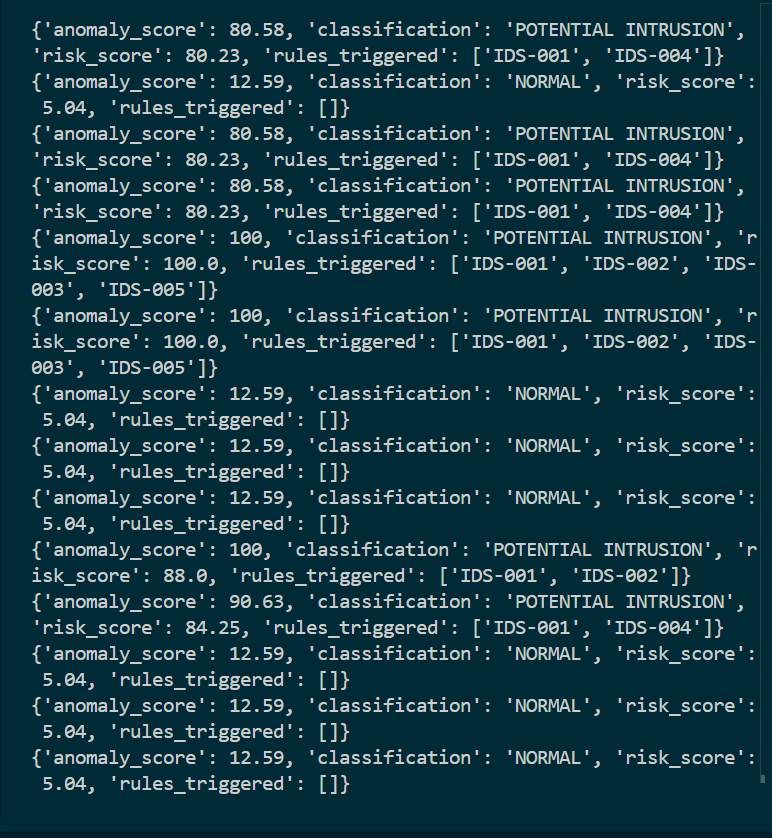
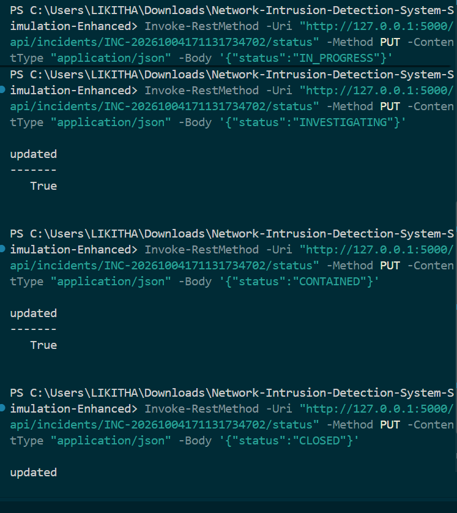

# Network Intrusion Detection System (IDS) Simulation

A defensive, localhost-only cybersecurity project that simulates network-flow telemetry, detects suspicious behavior with hybrid rules and anomaly scoring, enriches detections with an optional Random Forest model, correlates alerts, and exposes a SOC-style dashboard/API.

## Safety
This project uses synthetic flow records only. It does not scan, probe, exploit, attack, or generate malicious packets against real systems. Use it only for defensive learning in a local lab.

## Features
- 5,000-record synthetic network traffic dataset
- Continuous localhost traffic simulator
- Feature engineering and rule-based detection
- Statistical anomaly score (0-100)
- Hybrid risk scoring and classifications
- Optional Random Forest ML enrichment with real evaluation metrics
- Alert severity/status workflow and analyst notes
- Alert correlation by source IP and time window
- Incident creation and status workflow
- Flask REST API
- SOC dashboard with live cards, charts, recent alerts, and ML metrics
- 37 automated tests

## Run
```powershell
..\.venv\Scripts\activate
$env:PYTHONPATH="."
python simulator\generate_dataset.py
python ml\train_model.py
python backend\app.py
```

In a second terminal:
```powershell
..\.venv\Scripts\activate
$env:PYTHONPATH="."
python simulator\traffic_simulator.py --mode mixed --speed fast
```

Open `http://127.0.0.1:5000`.

## API highlights
- `GET /api/dashboard/stats`
- `GET /api/dashboard/alerts`
- `GET /api/flows`
- `GET /api/alerts`
- `GET /api/correlations`
- `GET /api/incidents`
- `POST /api/incidents`
- `PUT /api/incidents/<incident_id>/status`
- `GET /api/ml/metrics`
- `POST /api/ml/evaluate`

## Testing
```powershell
$env:PYTHONPATH="."
pytest -v
```

## Project structure
- `simulator/` synthetic dataset and traffic replay
- `ids/` detection, anomaly, correlation, incident, and ML logic
- `ml/` model training/evaluation
- `backend/` Flask API
- `frontend/` dashboard
- `tests/` automated tests
- `docs/` architecture notes
- `reports/` project report

- ## 📸 Screenshots

### Intrusion Detection Results



### Incident Response Workflow




